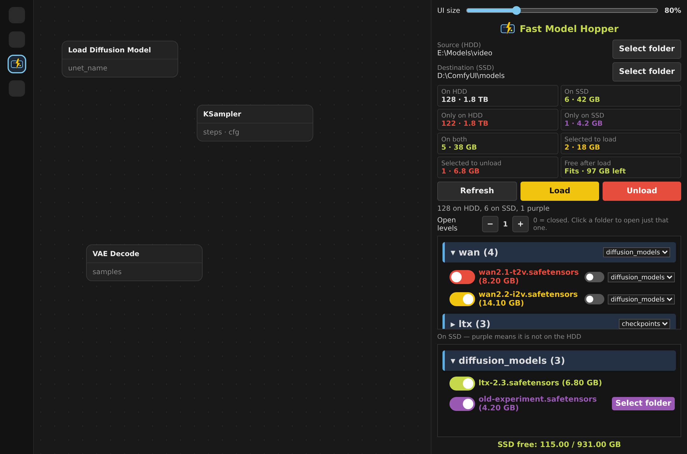
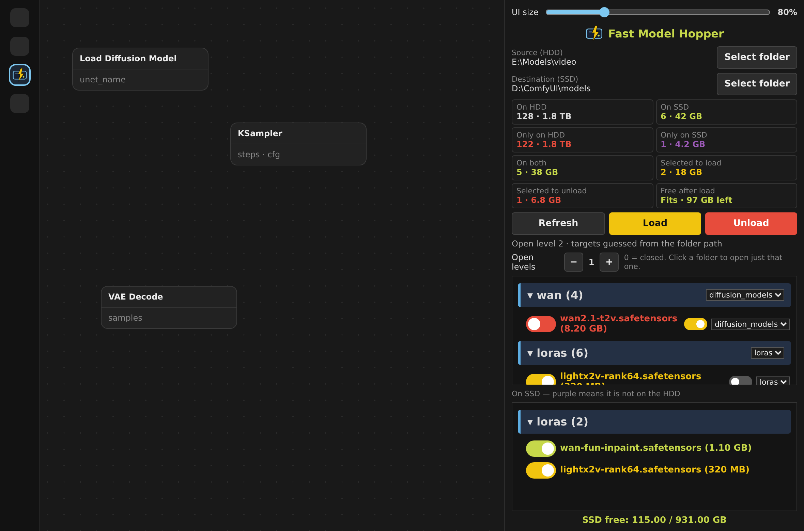
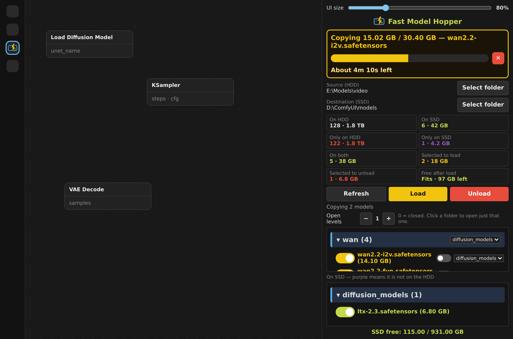
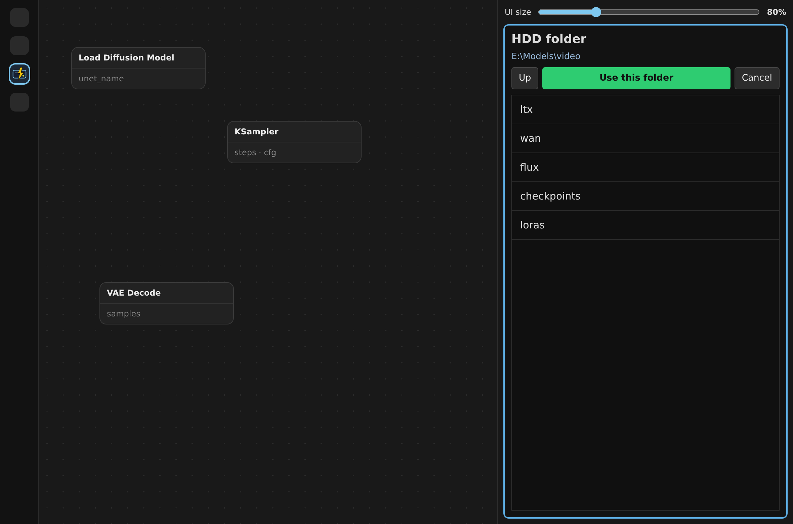
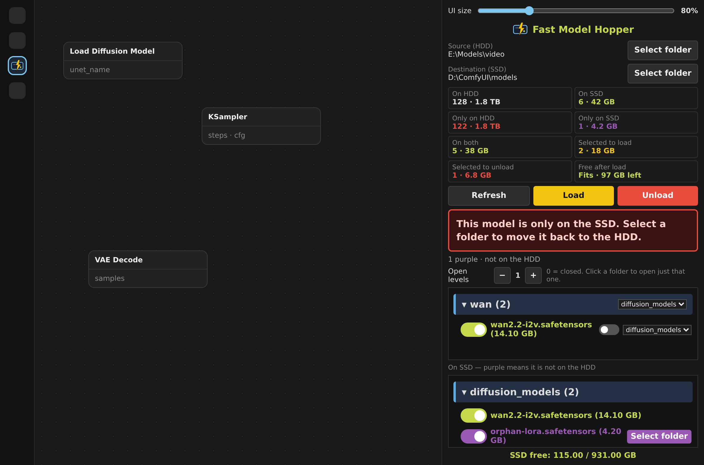

# Fast Model Hopper

ComfyUI sidebar that hops models from a slow HDD onto the fast SSD where ComfyUI loads them. The library stays on the hard drive. Only the models you pick sit on the SSD, and unloading deletes just that copy.

## What it does

ComfyUI reads models from the SSD `models` folder. That disk is fast and fills up. The rest of the library lives on a large HDD, which is too slow to use directly.

Fast Model Hopper copies the files you choose from the HDD into the right ComfyUI folder on the SSD. When you are done, Unload deletes only the SSD copy. The HDD original is never moved or deleted.

- Same folder tree as the HDD library
- Per-model and per-folder target (`checkpoints`, `loras`, `diffusion_models`, …)
- Targets are guessed from the folder path. If nothing matches, the default is `diffusion_models`
- Optional keep-folders knob. Off copies the file only. On recreates the HDD folders
- Live copy bar in gigabytes, with time left, and a stop button that deletes the half-written file
- Purple models are on the SSD but missing from the HDD. Each one can be moved back with its own Select folder
- Stats for counts, sizes, what is selected, and whether the selection fits on the SSD

## Screenshots

The HDD library, knobs, guessed targets, and the stats panel.

Folder targets and the keep-folders knob. Yellow-green is already on the SSD. Yellow is selected.

Copy progress follows the bytes. 15 GB of 30 GB stays near 50 percent. The cross stops the transfer and removes the partial file.

Select folder opens inside the panel. No path typing.

A model that exists only on the SSD is purple, with its own Select folder. Warnings use a large panel of their own.

## Install

1. Copy this folder to `ComfyUI/custom_nodes/ComfyUI-FastModelHopper`.
2. Restart ComfyUI.
3. Open the **FMH** tab on the left sidebar. The icon is a drive with a thunder bolt.

Requires the ComfyUI desktop or a local ComfyUI with the sidebar API. No extra Python packages.

## How to use

1. **Select folder** for the HDD library, then for the SSD `models` folder.
2. **Open levels** — `0` keeps every folder closed (click one to open it). `1` opens the first level, and so on.
3. Turn a red knob to yellow to select a model. **Load** copies it.
4. The small knob beside a target menu keeps the folder hierarchy. It starts off.
5. A loaded model is yellow-green. Turn that knob to yellow and press **Unload** to remove it from the SSD.
6. **Refresh** rescans both disks and repaints every name and knob.
7. **UI size** at the top scales the whole panel. The size is remembered.

## Colors

| Color | Meaning |
|---|---|
| Red | On the HDD only. Knob off. |
| Yellow | Selected to load, or selected to unload. |
| Yellow-green | On the HDD and on the SSD. |
| Purple | On the SSD only. Not on the HDD. |

The title turns yellow-green when anything is loaded on the SSD.

## Stats

Under the destination path:

- On HDD, on SSD, only on HDD, only on SSD, on both
- Selected to load, selected to unload
- Free after load — whether the selection fits, or by how much it is too big

Each line is a count and a size.

## Notes

- Copy, not move. Unload never deletes the HDD file.
- A stopped copy deletes the `.fdlpart` temp file. Models that already finished stay.
- One model is copied at a time, which is the right speed for a single hard drive.
